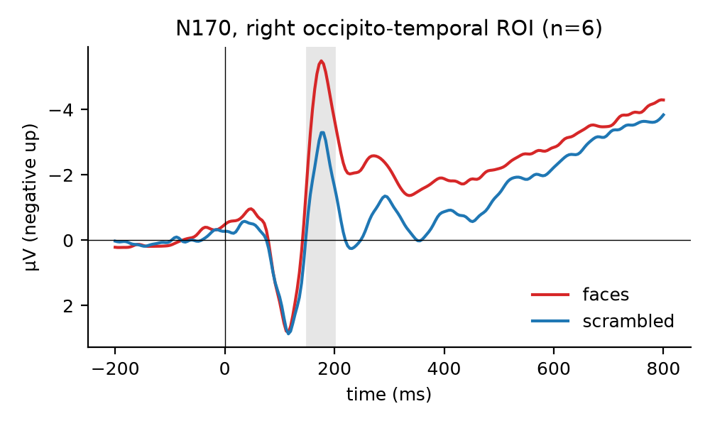
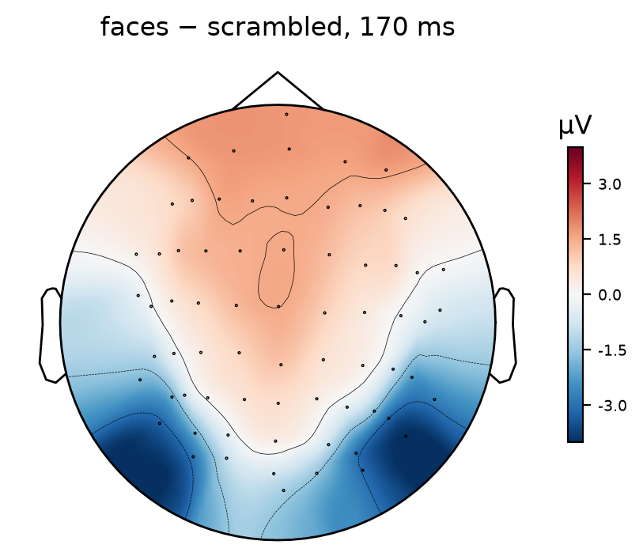
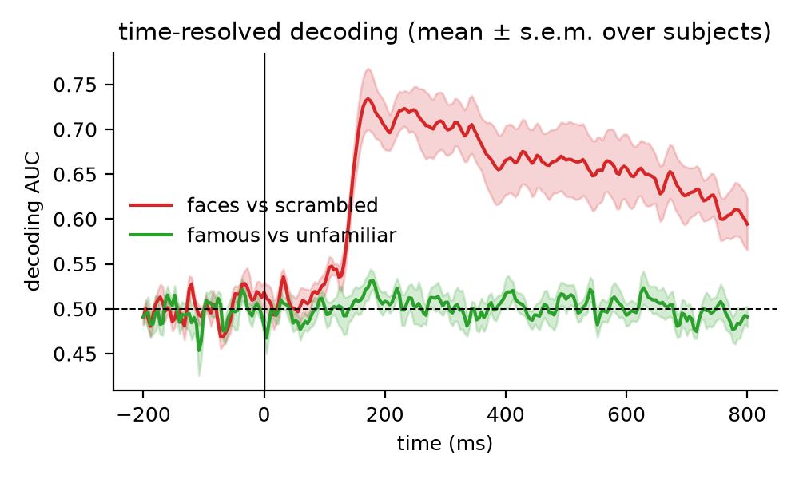

# Face processing in EEG: N170 and time-resolved decoding

A small, fully reproducible analysis of how the human brain distinguishes faces from non-faces,
using open EEG data and MNE-Python. It is a first step towards my research interest: comparing how
brains and machine-learning models represent identity and emotion in faces.

## Data

[OpenNeuro ds002718](https://openneuro.org/datasets/ds002718): the EEG part of the multi-subject face
processing dataset of Wakeman & Henson (2015), repackaged in BIDS/EEGLAB format by Martinez, Truong,
Makeig & Delorme. Participants viewed **famous**, **unfamiliar** and **scrambled** faces while
70-channel EEG was recorded (resampled to 250 Hz). This analysis uses six participants
(sub-002 to sub-007), 700–880 clean trials each.

## Methods

- **Preprocessing (MNE-Python):** 0.1–40 Hz band-pass, average reference, epochs from −200 to 800 ms
  with baseline correction. Bad channels (median peak-to-peak amplitude > 3× the channel median) are
  interpolated; epochs exceeding 150 µV peak-to-peak are rejected (79–99% of trials kept per participant).
- **Electrode positions:** taken from the BIDS `electrodes.tsv` files, which use the EEGLAB convention
  (x → nose, y → left ear). They are converted to MNE's head frame, and the orientation was verified
  with blink artefacts (the most VEOG-correlated electrodes are frontal).
- **N170:** mean amplitude 150–200 ms over a right occipito-temporal region of interest chosen from
  electrode positions alone (the six channels nearest to x = +5 cm, y = −6 cm), not from the face effect.
- **Decoding:** at every time point, a logistic regression on all 70 channels (standardised, balanced
  classes, 5-fold stratified cross-validation) classifies **faces vs. scrambled** and
  **famous vs. unfamiliar**; performance is the area under the ROC curve (AUC; chance = 0.5).

## Results (n = 6)

| | Result |
|---|---|
| N170 (faces − scrambled, 150–200 ms) | **−2.1 µV** on average; more negative for faces in **6 of 6** participants |
| Faces vs. scrambled decoding | peak **AUC 0.73 at 172 ms**, above chance until the end of the epoch |
| Famous vs. unfamiliar decoding | close to chance (peak AUC 0.53) |

The face-sensitive N170 appears over both occipito-temporal regions, with the opposite (positive)
polarity over frontal sites, and the multivariate decoder reaches its maximum at the same latency.
Telling famous from unfamiliar faces is much harder from a few hundred trials per participant, which
is consistent with familiarity effects being smaller and appearing later than the face/non-face
distinction. Natural next steps are more participants, time-generalisation and representational
similarity analysis comparing EEG patterns with the layers of face- and emotion-recognition networks.

## Run it

- **Colab / Kaggle:** open `eeg_face_decoding.ipynb` and run all cells (CPU is enough; about 20 min
  for six participants). The data are downloaded from the public OpenNeuro bucket.
- **Locally:** `pip install mne scikit-learn pandas matplotlib` and
  `python eegfaces.py --subjects 2 3 4 5 6 7 --out results`.

## References

- Wakeman, D. G., & Henson, R. N. (2015). A multi-subject, multi-modal human neuroimaging dataset.
  *Scientific Data*, 2, 150001.
- Gramfort, A., et al. (2013). MEG and EEG data analysis with MNE-Python. *Frontiers in Neuroscience*, 7, 267.
- Bentin, S., Allison, T., Puce, A., Perez, E., & McCarthy, G. (1996). Electrophysiological studies of
  face perception in humans. *Journal of Cognitive Neuroscience*, 8(6), 551–565.

---
Ari Ernesto Ortiz Castellanos
